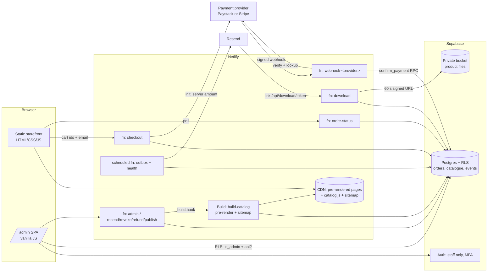

# Carmen Business Web: Architecture Review

| Item | Value |
|---|---|
| Version | 0.1 (for review) |
| Date | 28 October 2026 |
| Authoritative scope | *CarmenBusinessWeb Development Specification v1.0* ("the spec") |
| Repository state reviewed | `claude/trusting-franklin-l4z0a1` @ `0621530` |
| Status | **Plan only. No implementation has started.** Approval required before PR 0. |

Companion document: [`02-implementation-backlog.md`](02-implementation-backlog.md) (PR plan, tasks, acceptance mapping).

---

## 1. Executive summary

1. **Keep the storefront.** The static HTML/CSS/JS front end is sound, tested and fast. No technical reason was found to migrate to Next.js (see §5, ADR-01). It will be kept and extended with a small build step.
2. **The commerce backend does not exist yet.** The current checkout is a stateless prototype. It has no order record, no payment confirmation, no fulfilment, no delivery and no admin. Its success page announces "order confirmed" from the browser redirect alone. That breaks spec §4.1, and it **must not be deployed with live keys**.
3. **The payment gateway decision blocks payment work.** Stripe lists South Africa only as an "extended network" country tied to Paystack, not as a standard self-serve merchant country. If the business is registered in South Africa, Paystack is the likely gateway, and settlement will probably be in ZAR. The design therefore puts payments behind a provider adapter, so PR 0 and PR 1 can proceed before the decision is made.
4. **Target architecture** (spec §5), validated:
   - Static site on Netlify.
   - Netlify Functions for checkout, webhooks, downloads, status and admin operations.
   - Supabase Postgres with RLS for orders and catalogue.
   - A private Supabase Storage bucket for files.
   - Supabase Auth with MFA for staff only.
   - Resend for transactional email through an outbox with retries.
5. **Delivery plan:** 14 small PRs (PR 0–13) in the spec's five phases. Each has its own tests and maps to the acceptance tests in spec §7.

---

## 2. Audit of the existing implementation

### 2.1 Inventory

| Area | Files | Assessment |
|---|---|---|
| Storefront pages | `index.html` (shop), `product.html`, `cart.html`, `reviews.html`, `free.html`, `about.html`, `contact.html`, `success.html`, `terms.html`, `privacy.html`, `404.html` | Thin shells. All rendering is in JS. Consistent and accessible baseline. |
| Content / catalogue | `assets/js/site-config.js` | Single public file holding brand, nav, **products and prices**, reviews, coupons and popup. |
| Pure logic | `assets/js/lib.js` | Filtering, sorting, pagination, cart maths in integer cents, review stats, URL safety, escaping. Well-tested and reusable. |
| UI logic | `assets/js/main.js` (~480 lines) | Header/footer, cart drawer, popup, forms and all page renderers. Uses `innerHTML` with consistent escaping. |
| Styles | `assets/css/styles.css` | Token-based theme, dark mode, responsive, reduced motion. |
| Checkout prototype | `netlify/functions/checkout.js` | Stateless Stripe Checkout Session builder that re-prices from `site-config.js`. |
| Hosting config | `netlify.toml` | Publish root, function dir, basic security headers, 404. |
| Tests | `tests/site.test.js`, `tests/checkout.test.js` (21 tests), `tests/e2e.js` (13 Playwright scenarios) | Good coverage of current scope. |

### 2.2 What to preserve (working, keep as is or extend)

- **J1 (browse/search/filter):** search, price range, categories, sort, pagination and URL-persisted filters. Mobile is verified by e2e at 390 px with no horizontal overflow.
- Product page tabs, related products, `Product`/`AggregateRating` JSON-LD.
- Cart drawer and cart page, persisted locally. Coupon UI and totals use integer minor units.
- Contact form, free resources page, legal page shells, newsletter popup UI.
- Accessibility baseline: skip link, labelled inputs, keyboard tabs, Esc-to-close dialogs, focus styles, reduced motion.
- The test harness and e2e approach. It will be extended, not replaced.

### 2.3 Gaps against the spec

Severity: **P0** blocks launch or creates legal/financial risk. **P1** is required for the MVP. **P2** is polish.

| # | Finding | Spec ref | Sev |
|---|---|---|---|
| G1 | No order database. No pending order is persisted before payment, and no provider reference is attached. | 4.1, 5 | P0 |
| G2 | No webhook, signature verification or transaction lookup. A payment can succeed with no record anywhere. | 4.2 | P0 |
| G3 | `success.html` says "Your order is confirmed" and clears the cart **from the browser redirect alone**. | 4.1 | P0 |
| G4 | No fulfilment, private storage, signed downloads or delivery email (J3–J5). | 4.2 | P0 |
| G5 | Products, prices and coupons live in public JS. Changing a product needs a code deploy (J7), and there is nowhere to hold delivery data privately. | 4.1, 4.2, J7 | P0 |
| G6 | The checkout prototype **creates a new Stripe coupon on every request** to an unauthenticated, un-rate-limited endpoint. That is an abuse and noise vector. | 6 | P0 (prototype only, not deployed) |
| G7 | Per-product `checkoutUrl` "Buy now" / "Pay for X" links bypass any order record, so they would sell without fulfilment. | 4.1 | P0 |
| G8 | Placeholder reviews display a **"Verified buyer"** badge, and the shop intro claims "thousands of students". This is misleading if shipped. | 6, 10 | P0 (content) |
| G9 | Quantity can go up to 99. The spec says digital licences default to 1 unless multi-seat is defined. | 4.1 | P1 |
| G10 | No refund, chargeback or cancellation handling, and no access revocation. | 4.2 | P1 |
| G11 | No admin (J6, J7) and no metrics. | 4.3 | P1 |
| G12 | No email collection or consent capture at checkout. The newsletter has no consent wording or record, and marketing and purchase comms are not separated. | 4.3, J2 | P1 |
| G13 | SEO: product URLs are `product.html?id=` rendered client-side. There are no canonical URLs or sitemap. | 6 | P1 |
| G14 | No CI. Playwright is not a declared dev dependency, and there is no lockfile, `.env.example` or Node version pin. | 6, 8 | P1 |
| G15 | No Content-Security-Policy. Inline `style=""` attributes (cover colours, star widths) will need `style-src 'unsafe-inline'` or a refactor. | 6 | P2 |
| G16 | "First order" discount (SAVE10) cannot be enforced without identity, and it is advertised in the public announcement bar. | 4.1 | P2 (business decision) |
| G17 | No monitoring, alerting, backup or restore runbook. | 6 | P1 |

---

## 3. Target architecture

### 3.1 Purchase flow (J2 → J5)

1. **Checkout** (`POST /api/checkout`). The browser sends `{items:[productId], email, couponCode?, consents, expectedTotal}`. The server:
   - loads **published** products and the coupon from the DB;
   - computes the total in minor units;
   - returns `409 price_changed` if `expectedTotal` differs, which is for user experience only and never used for charging;
   - inserts `orders` (status `pending`) and `order_items` with a price snapshot;
   - initialises the provider transaction with `reference = orders.reference` and the server amount and currency;
   - returns the provider redirect URL.
2. **Webhook** (`POST /api/webhooks/<provider>`). The function:
   - reads the raw body and verifies the signature in constant time;
   - inserts into `payment_events` with `UNIQUE(provider, provider_event_id)`; a duplicate returns 200 and stops;
   - **looks the transaction up from the provider's API**;
   - checks amount, currency, reference and live/test mode against the order;
   - calls the Postgres function `confirm_payment()` in **one transaction**.

   `confirm_payment()` marks the order `paid` and creates `fulfilments` per item and asset (with `UNIQUE(order_item_id, asset_id)`). It also creates `delivery_tokens` and enqueues an `email_events` outbox row (with `UNIQUE(order_id, template, dedupe_key)`). Any failure marks the event `failed` for replay.
3. **Success page** polls `GET /api/order-status?ref=&k=`. `k` is a random per-order access key returned at checkout and held in `sessionStorage`. The page shows **"Payment received"** only when the server says `paid`. Otherwise it shows a neutral "We're confirming your payment…" message with a support path, and it clears the cart only on `paid`.
4. **Email** is sent by a scheduled outbox worker (every few minutes) and on demand right after confirmation. It retries transient failures with backoff and records each attempt. The order stays `paid` if email is down, which satisfies the "Email outage" test.
5. **Delivery**, per item:
   - **File:** the link `/api/download/<token>` uses an opaque token, of which only a SHA-256 hash is stored. It checks the order is paid, the token is not revoked or expired, and the download count is under the limit. It then issues a **60-second Supabase signed URL** and redirects with 302. Permanent storage URLs never appear in HTML, JS or email.
   - **External, instant:** the course URL and instructions come from `product_assets` in the DB and appear only in the email and the authenticated status view. They never appear in public config.
   - **External, manual:** the fulfilment is `action_required` and the email carries truthful timing wording. The admin marks it done, which triggers a "your access is ready" email.
   - **Mixed / bundle:** each item resolves to its own assets, so one order can produce several fulfilments of different kinds in one email.

### 3.2 Refunds, chargebacks, cancellation

Provider refund and dispute events go through the same verified, idempotent webhook path. The handler:
- moves the order to `refunded`, `partially_refunded` or `disputed`;
- **revokes** delivery tokens so future downloads fail;
- creates an admin task for any external course access that must be revoked manually;
- sends the refund email.

Financial rows are never deleted; corrections are new rows.

### 3.3 Catalogue publishing (J7 without code deployment)

The admin edits products in the DB. The storefront needs crawlable HTML and a fast CDN, so **"Publish changes" in the admin triggers a Netlify build hook**. That build runs a ~100-line `scripts/build-catalog.mjs`, which:
- reads the `public_catalog` view (published products only, with no delivery data);
- writes `assets/js/catalog.js`, which replaces `products` in `site-config.js`;
- pre-renders `/product/<slug>/` pages with canonical URLs and JSON-LD;
- writes `sitemap.xml`.

Netlify deploys are atomic, so a failed build leaves the previous site live. **Checkout always prices from the live DB**, so a publish delay can never undercharge. The worst case is a `price_changed` prompt.

### 3.4 Admin

`/admin/` is a small vanilla-JS single-page app, in keeping with the storefront. It covers:
- staff sign-in with Supabase Auth (email + password + **TOTP MFA required**);
- no public sign-up: admin rows in `admin_profiles` are created by an owner, through a migration or seed script;
- reads and catalogue edits through PostgREST under **RLS policies requiring `is_admin()` and `auth.jwt()->>'aal' = 'aal2'`**, so the database enforces roles even if the UI is bypassed;
- privileged operations (resend, revoke/renew links, mark manual fulfilment done, record refund, upload-URL issuance, publish) through Netlify Functions that verify the JWT **and** re-check the role, written to an append-only `audit_log`.

Metrics (completed orders, gross sales, refunded orders, top products, with tax shown separately) come from SQL views.

### 3.5 Data model (summary; full DDL in PR 1)

All money is stored as `bigint` minor units with an explicit `currency char(3)`. Timestamps are `timestamptz`, and IDs are UUIDs.

| Table | Key columns / constraints |
|---|---|
| `categories` | `slug UNIQUE`, `name`, `sort` |
| `products` | `slug UNIQUE`, `type (course\|book\|guide\|template\|bundle)`, `title`, `summary`, `description`, `price_minor`, `compare_at_minor`, `currency`, `status (draft\|published\|archived)`, `images jsonb`, `allow_quantity bool DEFAULT false` |
| `product_categories` | `PK(product_id, category_id)` |
| `bundle_items` | `PK(bundle_id, product_id)`, check no self-reference |
| `product_assets` | `kind (file\|external)`, `storage_path` (file), `external_url`, `instructions`, `access_mode (instant\|manual)`, `manual_eta_text` (private table; no anon access) |
| `coupons` | `code UNIQUE (upper)`, `percent_off` or `amount_off_minor`, `starts_at`, `ends_at`, `max_redemptions`, `per_email_limit`, `active` |
| `orders` | `reference UNIQUE`, `access_key_hash`, `email`, `status (pending\|paid\|failed\|expired\|refunded\|partially_refunded\|disputed)`, `subtotal_minor`, `discount_minor`, `tax_minor`, `total_minor`, `currency`, `provider`, `provider_txn_id UNIQUE NULLS DISTINCT`, `livemode`, `marketing_opt_in bool DEFAULT false`, `terms_accepted_at` |
| `order_items` | snapshot of `title`, `unit_price_minor`, `qty`, `product_id` |
| `payment_events` | `UNIQUE(provider, provider_event_id)`, `type`, `payload jsonb`, `status (received\|processed\|ignored\|failed)`, `error`, `attempts` |
| `fulfilments` | `UNIQUE(order_item_id, asset_id)`, `kind`, `status (queued\|delivered\|action_required\|revoked\|failed)` |
| `delivery_tokens` | `token_hash UNIQUE`, `fulfilment_id`, `expires_at`, `max_downloads`, `download_count`, `revoked_at` |
| `email_events` | outbox: `UNIQUE(order_id, template, dedupe_key)`, `status (queued\|sent\|failed)`, `attempts`, `next_attempt_at`, `provider_message_id`, `last_error` |
| `admin_profiles` | `user_id PK → auth.users`, `role (owner\|admin\|support)` |
| `audit_log` | append-only (no UPDATE/DELETE grants), actor, action, entity, before/after |

**RLS posture:** RLS is enabled on every table, and the default is *deny*. `anon` can read only the `public_catalog` view. Customers never get DB credentials. They interact only through functions. The **service-role key is used only by the webhook, outbox, download and checkout functions**, never in the browser.

---

## 4. Risk register

| ID | Risk | Likelihood / Impact | Mitigation |
|---|---|---|---|
| R1 | Gateway ineligible for the merchant's country. Stripe is not a standard self-serve country for South Africa. | High / High | `PaymentProvider` adapter interface (`createTransaction`, `verifyWebhook`, `lookupTransaction`, `parseRefund`). Implement the confirmed provider first. Decision D1 before PR 3. |
| R2 | Settlement currency mismatch: a ZAR-settling account versus the USD prices shown today. | High / Med | Single store currency in the MVP (D2). Currency is stored per product and order, and checkout rejects a mismatch. |
| R3 | Granting access from a redirect, or a double webhook causing double delivery. | Med / High | Webhook-only fulfilment, DB unique constraints, `confirm_payment()` in one transaction, and replay tests (spec §7 "Webhook replay" ×3). |
| R4 | Leaking files or external course links. | Med / High | Private bucket, hashed opaque tokens, 60 s signed URLs, a private `product_assets` table, and a "no secrets in build output" CI check that greps `dist` for storage paths and asset URLs. |
| R5 | Admin privilege escalation. | Low / High | No sign-up route, roles enforced by RLS (aal2), functions re-check the role, audit log, RLS test suite run as anon, customer-like and admin JWTs. |
| R6 | Email deliverability or outage. | Med / Med | Verified sending domain (SPF/DKIM/DMARC), outbox with retry and backoff, admin resend, alert on `failed` rows. |
| R7 | **Supabase free tier pauses inactive projects** and has limited backups. | High / High | Production on a paid tier (needs approval, D9). Staging can be free. Document the restore procedure. |
| R8 | Netlify function rate limiting exists only as a per-function `config.rateLimit` (functions v2), and plan support must be confirmed. | Med / Med | Migrate the functions to v2 and set `rateLimit` on checkout, webhook and download. Fall back to a DB counter if the plan lacks it. |
| R9 | Serverless cold starts and timeouts on webhooks; providers retry, and Paystack expects a quick 200. | Low / Med | Verify, persist the event and return 200 fast. Heavy work goes in the same request only if it is under the budget, otherwise the scheduled worker picks up `received` events. |
| R10 | Displayed prices are stale after an admin edit before the rebuild completes. | Med / Low | Checkout prices from the DB and returns `409 price_changed`. Publish shows build status. |
| R11 | Misleading content at launch (placeholder reviews and claims). | High / High (consumer law) | Content gate in PR 12. Remove the "Verified buyer" badge until reviews are real. Add a lint test that fails the build on placeholder markers. |
| R12 | Scope creep into LMS or portal. | Med / Med | Spec §9 exclusions restated in each PR template. External courses are delivered as link + instructions only. |
| R13 | Single developer bus-factor and an AI-generated codebase. | Med / Med | Small PRs, ADRs, runbooks, tests as documentation, and human review on each PR. |
| R14 | Key leakage. | Low / High | Secrets only in Netlify env per context (test vs live), `.env.example` without values, secret scanning in CI, separate Supabase projects for staging and prod. |

---

## 5. Architecture decision records (proposed)

| ADR | Decision | Rationale |
|---|---|---|
| **01** | **Keep the static front end. Do not migrate to Next.js.** | The front end already meets J1 and is fully tested. Each spec gap is in the backend, admin or SEO, and all of these are met with functions, an admin SPA and a ~100-line pre-render build. Next.js would mean a rewrite and re-test of working UI, a heavier runtime and a new framework for the client to maintain. **Revisit only if** dynamic SSR personalisation or a large catalogue (more than a few hundred products) is required. |
| 02 | **TypeScript for functions and scripts; plain JS stays for the storefront.** | The spec asks for typed data models. Types are generated from the schema (`supabase gen types`), and Netlify bundles TS natively. The storefront needs no change. |
| 03 | Business-critical state transitions live in **Postgres functions** (`confirm_payment`, `record_refund`, `issue_delivery_tokens`). | This gives true transactions and idempotency at the DB, which the Supabase REST API cannot provide across several calls. It is testable with SQL tests. |
| 04 | **Outbox pattern for email.** | Payment confirmation never depends on email availability, and retries are safe and visible to the admin. |
| 05 | **Opaque download tokens → short-lived signed URLs.** | Links can be revoked and renewed (J6), counted, and expired, and the storage URL never persists. |
| 06 | **Catalogue source of truth moves to the DB. A build hook publishes static output.** | This meets J7 without a code deployment while keeping SEO and CDN performance. |
| 07 | **Payment provider adapter.** | The gateway is undecided (R1), and it keeps the provider-specific surface to about one file each. |
| 08 | **Digital licence quantity fixed at 1.** The cart shows no quantity control unless `allow_quantity` is set. | Spec §4.1. Multi-seat is out of scope until defined (D6). |

---

## 6. Outstanding decisions (client / owner inputs)

**Bold** items block the PR shown.

| ID | Decision needed | Recommendation | Blocks |
|---|---|---|---|
| **D1** | Business registration country, and **payment gateway** (Paystack or Stripe). | If registered in South Africa, use Paystack. Confirm account eligibility for digital goods. | **PR 3** |
| **D2** | Store / settlement currency, and whether international buyers see USD. | One currency in the MVP (likely ZAR); display-only conversion later. | **PR 3** |
| D3 | VAT registration and whether prices are tax-inclusive. Invoice requirements. | Tax-inclusive prices, `tax_minor` recorded, a receipt email with the VAT number if registered. | PR 6 (receipt), PR 11 (metrics) |
| **D4** | Per product: file, external link or both. Instant or manual external access, with realistic manual timing. | Capture in a product intake sheet. | **PR 5–6** test data; PR 12 content |
| D5 | Download expiry and limits. | Link valid 7 days, 5 downloads, renewable by admin. | PR 5 |
| D6 | Any multi-seat products? | No (quantity = 1). | PR 2, PR 3 |
| D7 | Refund policy and SLA, support email, support hours. | Needed for the email templates and terms. | PR 6, PR 12 |
| D8 | First-order discount rules (SAVE10): one per email? Keep advertising it publicly? | One redemption per email, server-enforced. Remove from the announcement bar or accept the leakage. | PR 3 |
| **D9** | **Approval of paid services**: Supabase plan for production (pausing and backups), Resend plan, Netlify plan (rate limiting), domain. | Supabase Pro for prod; free tiers for staging. | **PR 1 (staging can start free)**, PR 13 |
| D10 | Who owns the merchant, hosting, DNS and email accounts (the spec says the client). Who are the admin users, and who signs off the launch. | Client-owned accounts; developer invited with least privilege. | PR 8, PR 13 |
| **D11** | **Branching / PR base.** The repo's only branch is `claude/trusting-franklin-l4z0a1`, and it is the default. | Create a protected `main` from the current head, plus a `staging` branch tied to a Netlify staging context, with one feature branch per PR. **I need approval to create these branches** (my current permission is to push to the one designated branch only). | **PR 0** |
| D12 | Newsletter provider and consent wording. Does the popup discount require newsletter opt-in? | Separate, unticked opt-in at checkout. The popup is an explicit opt-in with a consent line. | PR 3, PR 12 |
| D13 | Reviews: will real, verifiable reviews be supplied, or should the reviews page be hidden until then? | Hide the page and badge until real reviews exist. | PR 12 |

---

## 7. Assumptions

- **A1.** No customer accounts. Guests are identified by email and order reference only (spec §1).
- **A2.** The catalogue stays small (tens of products), so pre-rendering on publish is cheap.
- **A3.** External course platforms are not integrated via API in the MVP (spec §9). Access is a link plus instructions, or manual.
- **A4.** All provider integration details will be re-validated against current provider documentation at the start of PR 3, as the spec requires.
- **A5.** No deployment, merge, paid service or live payment setting will be changed without explicit approval. The work targets local, CI and **staging (test mode) only**.

## 8. Sources consulted for provider assumptions

- Stripe availability in South Africa ("extended network" via Paystack), from secondary sources; **must be confirmed with Stripe directly**: [dodopayments.com](https://dodopayments.com/blogs/stripe-supported-countries-alternatives), [thecondia.com](https://thecondia.com/stripe-africa-payments-tax-2025/), [skydo.com](https://www.skydo.com/people-ask/how-to-use-stripe-in-south-africa)
- Paystack webhook signing (HMAC-SHA512 of the raw body with the secret key; retry schedule): [hookdeck.com guide](https://hookdeck.com/webhooks/platforms/guide-to-paystack-webhooks-features-and-best-practices)
- Netlify function rate limiting (`config.rateLimit`; not configurable in `netlify.toml` for functions): [docs.netlify.com](https://docs.netlify.com/manage/security/secure-access-to-sites/rate-limiting/)
