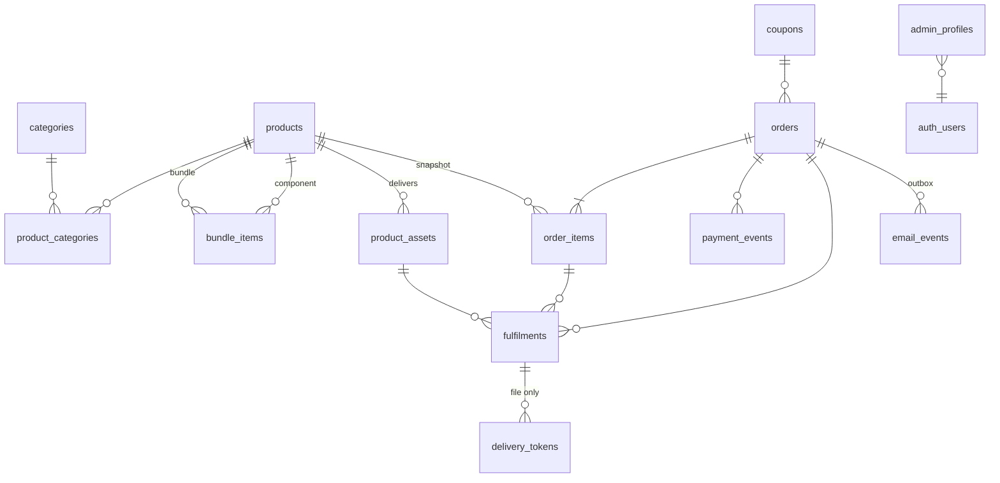

# Database: Schema, Security and Operations

| Item | Value |
|---|---|
| Introduced in | PR 1 |
| Engine | Supabase Postgres 17 (local via Supabase CLI 2.120.0) |
| Migrations | `supabase/migrations/` (forward-only) |
| Tests | `supabase/tests/*.test.sql` (pgTAP), `tests/db.api.test.js` (HTTP API surface) |
| Types | `types/database.ts` (generated; CI fails if stale) |

Design rationale is in the [architecture review](01-architecture-review.md) §3.5 and ADRs [0003](adr/0003-critical-state-transitions-in-postgres-functions.md), [0005](adr/0005-opaque-download-tokens-exchanged-for-short-lived-signed-urls.md) and [0006](adr/0006-catalogue-in-the-database-published-via-build-hook.md).

---

## 1. Entities



| Migration | Contents |
|---|---|
| `…210000_core_schema` | Enums, domains (`slug`, `currency_code`, `money_minor`, `email_address`), all tables, CHECK/UNIQUE constraints, indexes |
| `…210100_integrity` | Triggers: `updated_at`, bundle rules, the order state machine, immutability, no-delete rules, fulfilment/token integrity |
| `…210200_security` | Role helpers in `private`, RLS policies, grant hardening, the `public_catalog` view |
| `…210300_audit_log` | Append-only `audit_log` and audit triggers on catalogue, staff and order-state tables |

Money is always `bigint` minor units plus an ISO-4217 `currency`.

## 2. Access matrix (enforced by RLS and grants; verified by tests)

| Relation | anon (browser key) | Signed in, not staff | Staff at aal1 (no MFA) | support (aal2) | admin (aal2) | owner (aal2) | service role (server functions) |
|---|---|---|---|---|---|---|---|
| `public_catalog`, `categories`, published `products` / `product_categories` / `bundle_items` | read | read | read | read | read | read | all |
| Draft/archived products | no | no | no | read | read/write | read/write | all |
| `product_assets`, `coupons` | **denied** | no rows | no rows | read | read/write | read/write | all |
| `orders`, `order_items`, `payment_events`, `fulfilments`, `delivery_tokens`, `email_events` | **denied** | no rows; writes denied | no rows | read | read | read | write (subject to integrity triggers) |
| `admin_profiles` | **denied** | no rows; cannot self-assign | own row | own row | own row | all rows | write (grant script only) |
| `audit_log` | **denied** | no rows | no rows | no rows | read | read | **no write** (trigger-only) |

Notes:

- "denied" means the API returns `401 / 42501`, because privileges are revoked at the grant level. "No rows" means RLS filters everything out.
- Staff powers need an `admin_profiles` row **and** a JWT with `aal = aal2`, which a session only gets after completing TOTP MFA.
- `TRUNCATE`, `REFERENCES` and `TRIGGER` are revoked from API roles, because RLS does not govern them.
- There are no functions in `public`, so there is no RPC surface. The helpers live in `private`, which PostgREST does not expose.
- Public sign-up is disabled in `supabase/config.toml` (`[auth] enable_signup = false`). Staff are created by an owner with the service role (script in PR 8).

## 3. Integrity guarantees (hold for every role, including the service role)

| Guarantee | Mechanism | Spec |
|---|---|---|
| Order amounts, currency, email and provider are immutable after insert | `orders_check_update` trigger | §7 Tampering |
| `total = subtotal − discount`; `line_total = unit × qty`; item currency = order currency | CHECK and trigger | §5 |
| Valid order transitions only, e.g. `pending → paid` needs `paid_at` + provider txn; `expired → paid` honours late payments; `refunded` is terminal | state-machine trigger | §4.1, §4.2 |
| Orders, order items, payment events, fulfilments and delivery tokens are never deleted | `forbid()` triggers | §4.2 audit |
| One stored webhook per `(provider, provider_event_id)`; one order per provider txn | UNIQUE | §7 Webhook replay |
| One fulfilment per `(order_item, asset)`; the asset must belong to the purchased product or bundle | UNIQUE and trigger | §7 Webhook replay, Mixed delivery |
| One outbox email per `(order, template, dedupe_key)`, NULLS NOT DISTINCT | UNIQUE | §7 Webhook replay |
| Download tokens: only SHA-256 hashes stored, file fulfilments only, count ≤ limit, revocation permanent | CHECK and trigger | §7 Download security |
| Refunded amount never decreases or exceeds the total | CHECK and trigger | §7 Refund |
| Audit log is append-only, even for the database owner | revoked grants and trigger | §6 |
| Manual external access must carry truthful ETA text; external links must be `https` | CHECK | §4.2 |

## 4. Local workflow

```bash
npm run db:start    # start Supabase locally (Docker), apply migrations + seed
npm run test:db     # schema lint (plpgsql_check) + pgTAP + API-surface tests
npm run db:reset    # rebuild from scratch after editing migrations/seed
npm run db:types    # regenerate types/database.ts (commit the result)
npm run db:stop
```

The seed (`supabase/seed.sql`) is **local/CI only**. It mirrors the storefront's placeholder catalogue in USD and covers every delivery shape (file, external-instant, external-manual, mixed, bundle), plus one draft and one archived product.

## 5. Writing migrations

1. `npx supabase migration new <name>`, then write SQL that is safe to run on a database holding real orders.
2. RLS goes on any new table in the same migration. The test *"RLS is enabled on every table"* fails otherwise.
3. Functions use `set search_path = ''` and fully-qualified names. `SECURITY DEFINER` only where required, and only in `private`.
4. Add pgTAP coverage, run `npm run db:types` and commit the types.

## 6. Rollback policy

- **Production: roll forward only.** Fix problems with a new corrective migration. Never drop financial or audit data.
- **Disposable environments (local, empty staging):** `supabase/rollback/<date>_prN_down.sql` removes a PR's objects. The PR 1 script was verified locally: after applying it, 0 tables, types or migration rows remained, and re-applying the migrations passed the full suite.
- **Backups and restore drill:** PR 13 runbook (needs the production plan decision, D9).

## 7. Decisions and deviations recorded in PR 1

- **No staff account in the seed** (the backlog said "one admin profile"). Tests create their own users, and real staff are granted only by an owner-run script (PR 8). This avoids committing a usable password.
- **Seed currency is USD** to match today's storefront. **D2 is now decided (ZAR, ADR-0009):** PR 3 migrates the catalogue and seed to rands, adds `payfast` to `payment_provider`, and adds ZAR-only constraints.
- **`[auth.email] enable_signup` must stay `true`.** In GoTrue it toggles the email/password provider itself. Setting it to `false` silently blocks staff sign-in, which the API test caught during development. Public sign-up is blocked by `[auth] enable_signup = false`.
- `product_type` adds `guide` and `template` beside `course`, `book` and `bundle`, per spec §1 ("courses, e-books, guides, templates and bundles").
